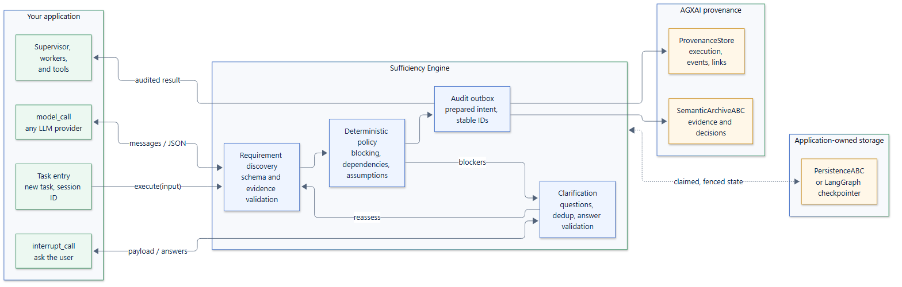

<p align="center">
  
</p>

<h1 align="center">Sufficiency Engine</h1>

<p align="center">
  <a href="https://github.com/smuniharish/sufficiency-engine/actions/workflows/ci.yml"></a>
  <a href="https://sufficiency-engine.readthedocs.io/"></a>
  <a href="https://pypi.org/project/sufficiency-engine/"></a>
  <a href="https://pypi.org/project/sufficiency-engine/"></a>
  
  
  <a href="https://github.com/smuniharish/sufficiency-engine/blob/main/LICENSE"></a>
</p>

**Decide whether a task has enough information to proceed, before your agent starts work.**

Sufficiency Engine finds the requirements a task depends on, asks only the
questions that matter, and records every readiness decision with
[AGXAI](https://agxai.readthedocs.io/) provenance. It works with any model
through one callback, and with LangGraph or any other framework.

<p align="center">
  
</p>

## Why Sufficiency Engine

A user asks an agent to deploy a service but names no platform. Today the usual
outcomes fall short:

- **The agent guesses.** It picks a platform, and the mistake surfaces only
  after the work is done.
- **The agent asks too much.** A string of loosely related questions, some
  already answered in the task, wears the user down.
- **The model decides alone.** Whether a task is ready rests on a model's
  judgment, with no rule an engineer can test.
- **Nobody can say why.** When a task proceeds on missing information, there
  is no record of what was known and what was decided.

How Sufficiency Engine addresses each one:

| Problem | What Sufficiency Engine does |
| --- | --- |
| Agents guess | Blocks the task until every required piece of information is supplied, answered, or covered by an approved assumption |
| Too many questions | Asks only for blocking information, combines and deduplicates questions, and never repeats a declined one |
| The model decides alone | The model proposes requirements; deterministic Python policy decides what blocks |
| No record of why | Records the evidence and every readiness decision through AGXAI; a failed audit is a failed assessment |

Sufficiency Engine decides readiness only. Your application keeps the model,
the conversation, the workflow, and the task itself.

## Highlights

- **Evidence, not guesses.** A requirement counts as available only when the
  model quotes the task or an accepted answer for it. Unsupported quotes are
  rejected.
- **Only the questions that matter.** Zero questions is a valid outcome.
  Answers are validated against typed constraints, and an invalid answer gets
  a targeted follow-up.
- **Audited with AGXAI.** Every terminal outcome records evidence, decisions,
  and their links, without the raw task or answer text.
- **Recoverable by design.** Session claims, revisions, and fencing protect
  concurrent use. An interrupted interaction or audit resumes without
  rediscovery or replayed side effects.
- **Provider- and framework-neutral.** Any model, sync or async, through one
  callback. LangGraph and OpenTelemetry are optional extras; storage and
  embeddings plug in through abstract base classes.
- **Bounded and typed.** Input sizes, requirement counts, dependency edges,
  questions, and iterations are limited by default. The package ships type
  hints and is tested on Python 3.12 to 3.15.

## Installation

```bash
pip install sufficiency-engine                 # core
pip install "sufficiency-engine[langgraph]"    # with the LangGraph integration
```

Or with [uv](https://docs.astral.sh/uv/): `uv add sufficiency-engine`. The core
depends only on AGXAI, Pydantic, and RapidFuzz; it does not install a model
provider.

Optional extras:

| Extra | Adds |
| --- | --- |
| `langgraph` | `build_assessment_graph`, a task-entry node with interrupts and checkpointed resumes |
| `observability` | `OpenTelemetryObserver` and AGXAI's OpenTelemetry support |

To call a hosted model, install its client yourself, for example `pip install openai`; see
[OpenAI-compatible models](https://sufficiency-engine.readthedocs.io/en/latest/examples/openai-compatible/).

## Quickstart

A deployment task names no platform. The engine asks one question, reassesses
with the answer, and returns an audited result. The model callback is
deterministic so the example runs offline; in your application it calls your
own model:

```python
import asyncio
import json

from sufficiency_engine import AnswerSubmission, InteractionResponse, SufficiencyEngine


async def model_call(messages):
    # Replace with your own model, e.g. `return await chat_model.ainvoke(messages)`.
    prior = json.loads(messages[-1]["content"])["prior"]
    answered = bool(prior and prior[0]["answers"] == ["Linux"])
    return {
        "requirements": [
            {
                "key": "platform",
                "description": "Deployment platform",
                "classification": "mandatory",
                "status": "available" if answered else "unresolved",
                "evidence_quote": "Linux" if answered else None,
                "necessity": "must_ask",
                "reason": "The deployment steps depend on the platform.",
                "question": "Which platform should the service be deployed on?",
                "answer_type": "string",
            }
        ]
    }


async def ask_user(payload):
    question = payload.questions[0]
    print("Question:", question.text)
    return InteractionResponse(
        answers=(
            AnswerSubmission(
                question_id=question.id,
                values={question.requirement_ids[0]: "Linux"},
            ),
        )
    )


async def main():
    engine = SufficiencyEngine(model_call=model_call, interrupt_call=ask_user)
    result = await engine.execute(input="Deploy the billing service.")
    print("Status:", result.status.value)
    print("Sufficient:", result.sufficient)
    print("Clarification rounds:", result.iteration_count)
    for requirement in result.requirements:
        print(f"  {requirement.key}: {requirement.status.value}, blocking={requirement.blocking}")
    print("Audited decisions:", len(result.provenance.decision_ids))


if __name__ == "__main__":
    asyncio.run(main())
```

Output:

```text
Question: Which platform should the service be deployed on?
Status: sufficient
Sufficient: True
Clarification rounds: 1
  platform: available, blocking=False
Audited decisions: 2
```

Run it with `uv run python examples/quickstart.py`. The
[quickstart guide](https://sufficiency-engine.readthedocs.io/en/latest/getting-started/quickstart/) explains each step.

### LangGraph

Add readiness as the entry node of your graph. Questions become LangGraph
interrupts, and answers resume from the checkpoint:

```python
from sufficiency_engine.integrations.langgraph import build_assessment_graph

builder.add_node("readiness", build_assessment_graph(engine))
```

See the [LangGraph integration](https://sufficiency-engine.readthedocs.io/en/latest/integrations/langgraph/).

### Your own storage

Sessions and AGXAI records are kept in memory by default. For recovery across
processes, implement `PersistenceABC` and `SemanticArchiveABC` for your
database, and check them with the extension skill's contract checker. See
[Use durable storage](https://sufficiency-engine.readthedocs.io/en/latest/guide/how-to/durable-storage/).

## Benchmarks

Library overhead with a deterministic local model and in-memory AGXAI, so model
and network time are excluded:

| Scenario | p50 ms | p95 ms |
| --- | ---: | ---: |
| Audited assessment of a complete task | 16.77 | 21.52 |
| Readiness policy, 256 requirements and 2,012 dependency edges | 10.58 | 15.77 |
| Lexical deduplication of 64 questions | 37.88 | 50.05 |

Measured on one machine; see [Benchmarks](https://sufficiency-engine.readthedocs.io/en/latest/benchmarks/) for the method,
duplicate-detection quality, and how to reproduce.

## Examples

Complete programs in [`examples/`](https://github.com/smuniharish/sufficiency-engine/tree/main/examples):

- [Quickstart](https://sufficiency-engine.readthedocs.io/en/latest/examples/quickstart/)
- [Standalone](https://sufficiency-engine.readthedocs.io/en/latest/examples/standalone/)
- [Supervisor and workers](https://sufficiency-engine.readthedocs.io/en/latest/examples/supervisor-worker/)
- [Observability](https://sufficiency-engine.readthedocs.io/en/latest/examples/observability/)
- [BGE-M3 duplicates](https://sufficiency-engine.readthedocs.io/en/latest/examples/bge-m3/)
- [PostgreSQL recovery](https://sufficiency-engine.readthedocs.io/en/latest/examples/postgres-recovery/)
- [OpenAI-compatible models](https://sufficiency-engine.readthedocs.io/en/latest/examples/openai-compatible/)

## Documentation

- [Getting started](https://sufficiency-engine.readthedocs.io/en/latest/getting-started/)
- [User guide](https://sufficiency-engine.readthedocs.io/en/latest/guide/)
- [Integrations](https://sufficiency-engine.readthedocs.io/en/latest/integrations/)
- [Architecture](https://sufficiency-engine.readthedocs.io/en/latest/architecture/)
- [Security](https://sufficiency-engine.readthedocs.io/en/latest/security/)
- [API reference](https://sufficiency-engine.readthedocs.io/en/latest/api/)

Two [Agent Skills](https://sufficiency-engine.readthedocs.io/en/latest/agent-skills/) teach coding agents such as
Claude Code, Codex, Cursor, and GitHub Copilot to use Sufficiency Engine
correctly. `sufficiency-engine` adds readiness checks to your application,
and `sufficiency-engine-extend` implements durable storage and embedding
models:

```bash
npx skills add smuniharish/sufficiency-engine
```

Sufficiency Engine is stable and follows semantic versioning: only a major
release changes the public API incompatibly, and stored sessions are versioned. See [Compatibility](https://sufficiency-engine.readthedocs.io/en/latest/project/compatibility/)
and the [changelog](https://github.com/smuniharish/sufficiency-engine/blob/main/CHANGELOG.md).

> [!WARNING]
> Readiness is not a safety guarantee. A model can miss or misclassify
> requirements, and the engine sees only the supplied task and answers. Your
> application remains responsible for authorization, task execution, and
> independent safety checks.

## Contributing

Contributions are welcome. See
[CONTRIBUTING.md](https://github.com/smuniharish/sufficiency-engine/blob/main/CONTRIBUTING.md) for the development setup
and checks, and [SECURITY.md](https://github.com/smuniharish/sufficiency-engine/blob/main/SECURITY.md) to report a
vulnerability.

## License

Apache License 2.0. See [LICENSE](https://github.com/smuniharish/sufficiency-engine/blob/main/LICENSE).