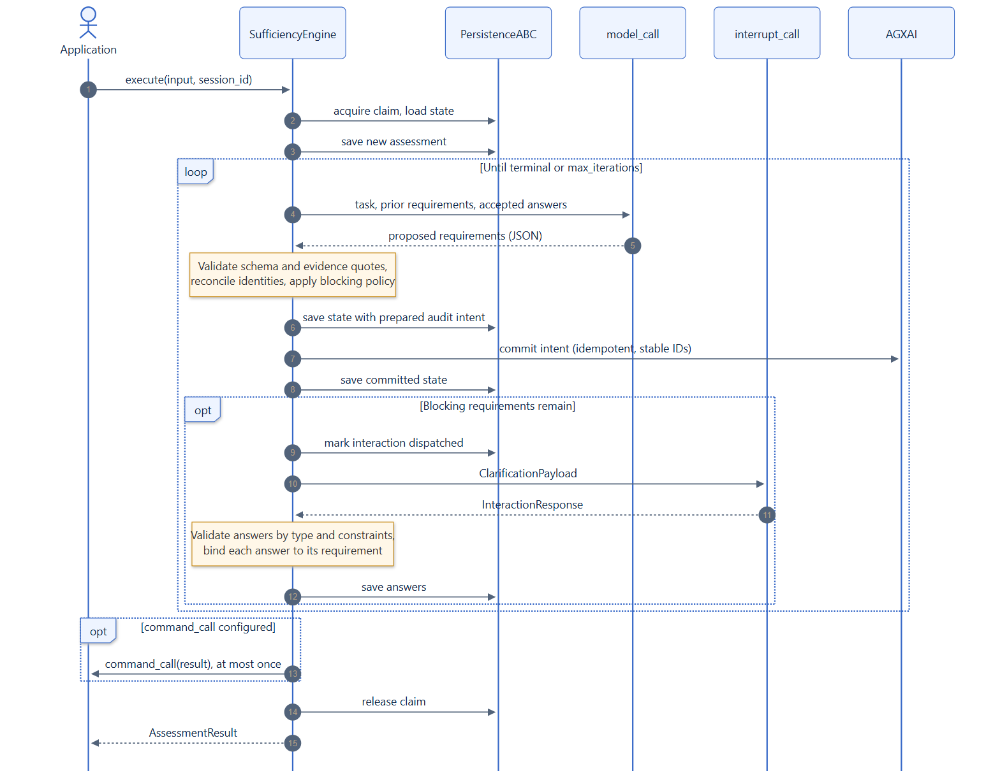

# Assessment lifecycle

An assessment is a small state machine with three phases (`discover`,
`waiting`, and `finished`) plus an optional pending audit record that must be
delivered before the engine moves on.

{ .diagram }

## Phases

| Phase | What happens | Leaves when |
| --- | --- | --- |
| `discover` | Calls the model, validates the proposal, applies the policy, plans decisions | A terminal outcome is chosen, or questions or assumptions are pending |
| `waiting` | Delivers the pending audit record, then asks through `interrupt_call` | A valid response is applied (back to `discover`), or a terminal outcome is chosen |
| `finished` | Delivers the final audit record and optional notification | Never; the result is returned on every later resume |

The state is saved after every transition. Before any phase runs, a pending
audit record is delivered first, so the engine never acts on an unaudited
decision.

## Planning

After the policy runs, planning picks the first matching rule:

1. No active requirements: `insufficient`, with an `empty_discovery` warning.
2. No blocking requirements: `sufficient`.
3. The iteration budget is used up: `iteration_limit_reached`.
4. Otherwise, each blocker gets a recorded decision: `must_ask` with a
   question, `may_assume` with an assumption, or `must_block`. A blocker the
   model marked `may_defer` or `not_needed`, or one the user declined, becomes
   `must_block`.
5. No question or assumption can be asked: `insufficient`.
6. Otherwise, the questions are combined, deduplicated, and checked against
   `Limits.max_questions`, and the assessment waits.

Without `interrupt_call`, a waiting standalone assessment finishes as
`insufficient` with its questions in the result.

## Budgets

- `max_iterations` (0 to 100, default 5) counts clarification rounds. Each
  applied response, and each rejected malformed response, uses one.
- `max_model_retries` (0 to 10, default 2) counts retries per model call after
  a `TransientModelError` or a timeout, with exponential backoff capped at one
  second.
- `Limits.callback_timeout_seconds` (default 120) bounds every callback. The
  session claim lasts at least 60 seconds, or three timeouts if longer, and is
  renewed before every step.

## Failure handling

| Failure | Outcome |
| --- | --- |
| Model error, invalid proposal, invalid dependencies, too many questions | Terminal `failed` with the error code, audited |
| AGXAI write fails | Retryable `failed`; the intent stays pending for resume |
| `interrupt_call` fails after dispatch | Retryable `failed`; resume with an explicit response |
| Malformed response | One iteration used; retryable `failed` with the questions still pending |
| `command_call` fails after dispatch | `CallbackError`; never repeated |
| Storage fails | `PersistenceError`; the claim is released when possible |

## Design decisions

**One assessment at task entry, not per tool call.** Assessing every model or
tool call would add latency and cost without changing the readiness question.
The host calls the engine when a task arrives, or explicitly for a genuinely
new task.

**A saved state machine instead of an in-memory loop.** Interactions can take
hours and processes restart. Saving after every transition costs a write per
step but makes every step resumable, and lets the engine detect an
interaction that might already have run.

**No automatic replay of side effects.** An `interrupt_call` or `command_call`
that may have run is never repeated, because asking a user twice or starting
work twice can be worse than an explicit, recoverable failure.
