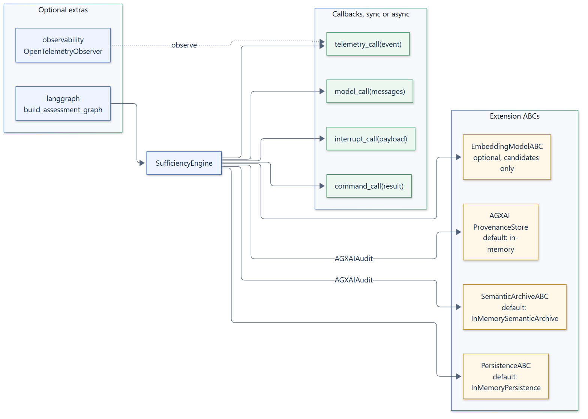

# Extensibility

The engine has two kinds of extension points, chosen by what they extend.

{ .diagram }

## Callbacks for behavior

Behavior that belongs to the application is a plain callable, sync or async:

| Callback | Receives | Returns |
| --- | --- | --- |
| `model_call` | Chat-style messages | Discovery JSON, as text, a mapping, or a chat message |
| `interrupt_call` | `ClarificationPayload` | `InteractionResponse` or a mapping |
| `command_call` | The final `AssessmentResult` | Ignored |
| `telemetry_call` | A sanitized `Observation` | Ignored |

A callable keeps the engine independent of any model provider, user interface,
or framework. Sync callables run in a worker thread, and every callback has a
deadline.

## Abstract base classes for components

Stateful components with a multi-method contract are abstract base classes:

| ABC | Default | Contract |
| --- | --- | --- |
| `PersistenceABC` | `InMemoryPersistence` | Claims, fencing, and revision-checked writes |
| `SemanticArchiveABC` | `InMemorySemanticArchive` | AGXAI plugin that keeps evidence and decision artifacts |
| `EmbeddingModelABC` | None | Vectors for duplicate-question candidates |

AGXAI's own `ProvenanceStore` is configured through `AGXAIAudit`. The engine
validates every component with `isinstance` at construction, so a wrong
component fails immediately instead of mid-assessment.

## Optional extras

Framework adapters live in `sufficiency_engine.integrations` and are imported
only by the application. The core never imports them.

| Extra | Adds |
| --- | --- |
| `langgraph` | `build_assessment_graph` |
| `observability` | `OpenTelemetryObserver`, and AGXAI's OpenTelemetry support |

## What is not an extension point

The readiness policy, evidence binding, lineage validation, and answer
validation are fixed. They define what "ready" means; making them pluggable
would let a deployment weaken the guarantees without noticing. Change them
through the project instead, with tests.

## Building an extension

The `sufficiency-engine-extend` [Agent Skill](../agent-skills/sufficiency-engine-extend.md)
guides adapters and integrations, and includes a contract checker for storage
adapters. See also [Use durable storage](../guide/how-to/durable-storage.md).
