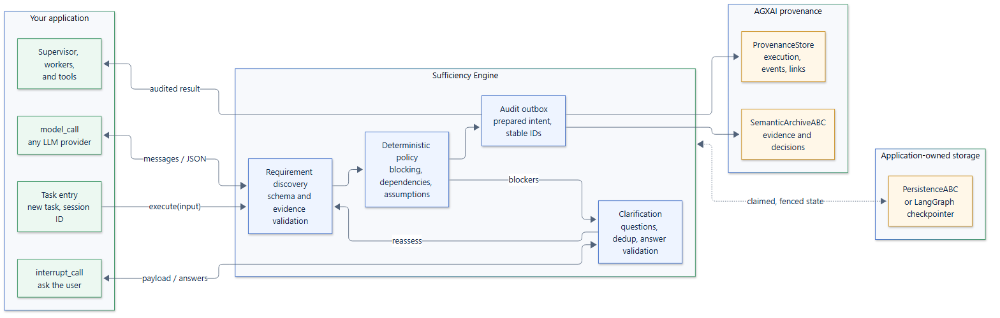

# Architecture

Sufficiency Engine is a small library with one job: decide, at task entry,
whether a task has enough information to proceed. The application keeps
ownership of everything else: the model, the user conversation, agents,
tools, workflows, and storage.

{ .diagram }

## Components

| Component | Responsibility | Module |
| --- | --- | --- |
| `SufficiencyEngine` | Runs the assessment lifecycle, sessions, and callbacks | `engine` |
| Discovery | Builds the model prompt and validates the model's JSON proposal | `_discovery` |
| Readiness policy | Decides deterministically which requirements block the task | `policy` |
| Clarification | Combines, deduplicates, and validates questions and answers | `_clarification` |
| Session state | The versioned, JSON-serializable state of one assessment | `_state` |
| Persistence | Claimed, fenced, revision-checked session storage | `persistence` |
| Audit | Prepares and delivers AGXAI provenance records | `provenance` |
| Models | Public Pydantic models and enums | `models` |
| Integrations | Optional LangGraph and OpenTelemetry adapters | `integrations` |

## Lifecycle

1. The application calls `execute` with a task. The engine claims the session
   and saves its initial state.
2. Discovery sends the task, prior requirements, and accepted answers to
   `model_call`, and validates the proposed requirements against the schema and
   the supplied text.
3. The policy computes which required requirements are still unavailable, and
   plans one decision for each: ask, assume, or block.
4. The audit record is prepared, saved with the session, and delivered to
   AGXAI.
5. If questions remain and `interrupt_call` is configured, the engine asks,
   validates the answers, and goes back to step 2.
6. On a terminal outcome, the engine delivers the final audit record, calls
   `command_call` once if configured, and returns the `AssessmentResult`.

Each step is detailed in [Assessment lifecycle](assessment-lifecycle.md).

## Design principles

- **The model proposes, the policy decides.** A model can claim information is
  present only by quoting it. Blocking, dependencies, and assumptions are
  decided by deterministic code.
- **Fail closed.** A model error, an invalid answer, an exhausted budget, or a
  failed audit never produces a ready result.
- **Audit before acting.** A result is returned only after its AGXAI record is
  delivered.
- **Never repeat an external side effect.** An interaction or notification
  that might have run is not repeated automatically.
- **Own only readiness.** No agent execution, conversation storage, model
  hosting, or orchestration.
- **Explicit extension points.** Callbacks for application behavior, and
  abstract base classes for storage and embeddings.

## In this section

-   **[Assessment lifecycle](assessment-lifecycle.md)**

    ---

    Phases, budgets, and terminal outcomes.

-   **[Requirements and evidence](requirements-and-evidence.md)**

    ---

    Identity, evidence binding, lineage, and reassessment.

-   **[Persistence](persistence.md)**

    ---

    Claims, fencing, revisions, and the audit outbox.

-   **[Provenance](provenance.md)**

    ---

    How AGXAI records are shaped and delivered.

-   **[Extensibility](extensibility.md)**

    ---

    Callbacks, ABCs, and optional extras.

