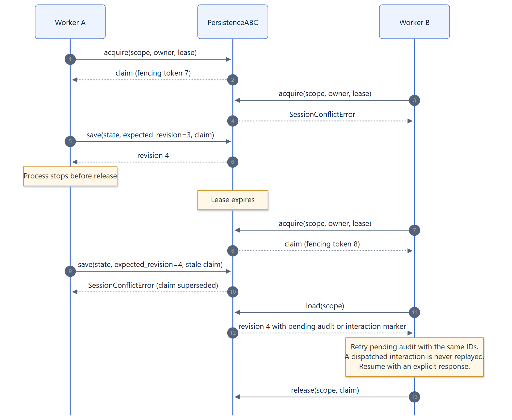

# Persistence

Standalone sessions are saved through `PersistenceABC` after every step. The
design goal is that **no two processes can advance the same assessment**, and
that a crash at any point leaves a state that can be resumed or reported
explicitly. For the user-facing guide, see
[Persistence and recovery](../guide/concepts/persistence.md).

{ .diagram }

## Claims and fencing

`execute` acquires an expiring, exclusive claim before it loads the session,
and renews it before every step. Each claim carries a fencing token. Every save
and delete must present the expected revision and the current claim, so:

- A concurrent writer fails at `acquire` with `SessionConflictError`.
- A paused writer whose lease expired, and whose session was claimed by
  another process, is fenced off when it tries to save.
- A stale revision is rejected; there is no last-writer-wins merge.

The lease is the larger of 60 seconds and three callback timeouts, so a
callback that runs to its deadline does not lose the claim.

## The audit outbox

The engine cannot write the session and AGXAI in one transaction. Instead, it
uses an outbox:

1. Prepare the audit intent, with stable IDs, and save it in the session.
2. Deliver it to AGXAI.
3. Clear it and save the session.

A crash between steps leaves the intent in the session, and the next resume
delivers it again with the same IDs. This gives at-least-once delivery, so the
AGXAI stores must treat repeated writes with the same ID as idempotent.

## Side-effect markers

Before calling `interrupt_call` or `command_call`, the engine saves a
"dispatched" marker. If the process stops before it records the outcome, a
resume sees the marker and reports the ambiguity instead of calling again.

## Versioning

The stored envelope has `version=1`, and the assessment state has
`schema_version=1`. A resume with an unknown version is rejected before any
model call or write. See [Compatibility](../project/compatibility.md).

## Alternatives considered

| Alternative | Why not |
| --- | --- |
| Process-local locks | Do not protect multiple workers or hosts |
| Last-writer-wins saves | Silently lose answers or audit state |
| Distributed transactions with AGXAI | Not available across arbitrary stores; the outbox is portable |
| A built-in database adapter | Every host already has its own database and policies; the ABC keeps the core dependency-free |

## Failure scenarios

| Scenario | Result |
| --- | --- |
| Store unavailable | `PersistenceError`; nothing is acted on |
| Crash after preparing the audit intent | Resume delivers it |
| Crash after dispatching a question | Resume reports `interaction_ambiguous` |
| Lease expires mid-step | The next save is fenced off |
| Corrupt or unknown stored state | `SerializationError` |
