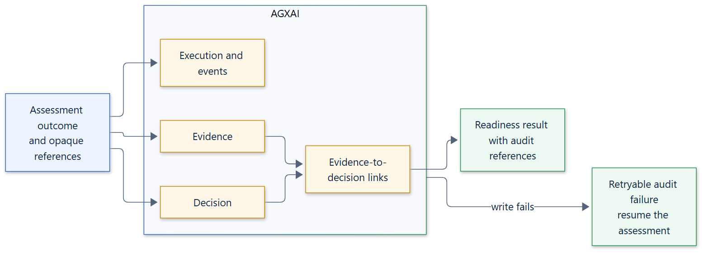

# Provenance

Sufficiency Engine uses AGXAI for every provenance responsibility: evidence,
decisions, attribution, lineage relationships, and explainability. It adds
only the mapping from an assessment to AGXAI's public models. For the
user-facing guide, see [Provenance](../guide/concepts/provenance.md).

{ .diagram }

## Mapping

| Assessment | AGXAI |
| --- | --- |
| Session scope | `ExecutionContext` with the application, tenant, `graph_id="sufficiency-engine"`, the run ID, and the session ID as the thread |
| Assessment run | `Execution`, plus `ExecutionStartedEvent` and `ExecutionCompletedEvent` or `ExecutionFailedEvent` |
| Task input, accepted answers, approvals, source references | `Evidence` of type `STATE`, with an opaque `SourceReference` |
| Pending or terminal outcome | `Decision` of type `CUSTOM` with the selected action and counts |
| Evidence considered for the decision | `ProvenanceLink` with relation `considered` |

The executions, events, and links are written to the AGXAI `ProvenanceStore`.
The evidence and decision are recorded through `XAIRuntime.record_artifact`,
which delivers them to the registered `SemanticArchiveABC` plugin.

## Guarantees

- **Strict.** The runtime runs in AGXAI's `STRICT` failure mode, with a
  timeout per operation. Any failure raises `ProvenanceError`, and no ready
  result is returned without a delivered audit record.
- **Sanitized.** Records contain IDs, statuses, and counts. Raw task text,
  answers, and questions are never written to AGXAI.
- **Scoped.** Each intent is checked against the session scope before it is
  written; a mismatch is rejected.
- **Replayable.** IDs are stable, so the outbox can deliver an intent again
  after a crash or outage.

## Boundaries

- AGXAI is the provenance and lineage system of record. Telemetry supports
  operational correlation; it does not replace the audit.
- Source references are attached to the assessment decision. The engine does
  not claim that a reference supports an individual requirement unless that
  relationship is established by the application.
- Delivery may be retried after an ambiguous failure. Use idempotent AGXAI
  stores; there is no cross-system exactly-once transaction.
