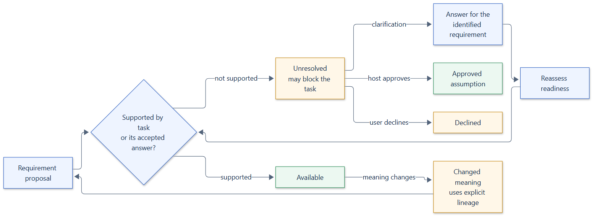

# Requirements and evidence

Requirement discovery is the only step a model influences, so it is the most
tightly constrained. This page explains why. For the field reference, see
[Requirements and evidence](../guide/concepts/requirements.md) in the guide.

{ .diagram }

## The problem

A language model is good at noticing what a task needs and bad at being a
source of truth. Left unchecked, it can claim a fact is present when it is not,
silently change what a requirement means between rounds, or reuse an old
answer for a different question. Any of these can produce a false ready
result, which is the most expensive outcome.

## Selected design

**Quote-bound evidence.** A requirement becomes `available` only when the
model quotes an exact substring of the task, or of a valid answer to that same
requirement. The engine resolves the quote to a stable evidence ID; it never
trusts the model's claim alone. Exact matching is strict, so a correct but
paraphrased claim is rejected. That trade-off favors false not-ready over
false ready.

**Answers belong to their requirement.** Each accepted answer is bound to the
requirement ID it was given for. On reassessment, a quote is searched only in
the task and in that requirement's own answers, or its lineage parents'
answers. An old answer cannot make a changed or different requirement
available.

**Frozen identity.** A key's description, classification, answer type, slot,
and constraints cannot change. A changed meaning needs a new key and explicit
lineage (`split`, `merge`, `supersede`, or `retire`), which the engine
validates and returns in `result.lineage`.

**Stable audit references.** Assessment and audit records retain stable
identifiers across a resume so applications can correlate them. Their internal
generation strategy is not part of the public API.

## Reassessment

After each clarification round, the model sees every prior requirement with
its frozen contract, status, lifecycle, and the answers accepted for it. It
must confirm availability with a new quote. An answered requirement whose
answer the model does not quote stays unresolved and keeps blocking.

## Failure scenarios

| Scenario | Result |
| --- | --- |
| Quote not found in supplied text | `model_response_error`; the assessment fails |
| Existing key changes meaning | `model_response_error` |
| Unknown or cyclic dependency | `model_response_error` or `invalid_dependencies` |
| Lineage weakens a classification or resurrects a key | `model_response_error` |
