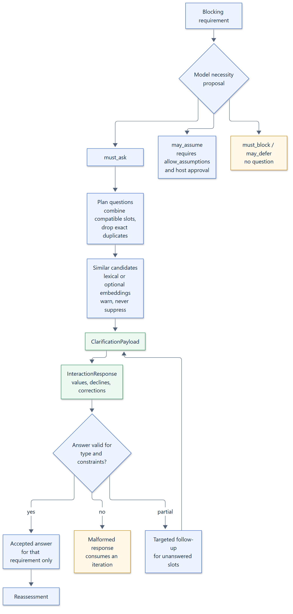

# Clarification

Missing information is not automatically a question. The engine asks only for
blocking requirements whose proposal includes a question, and zero questions is
a valid outcome. A non-interactive preview can also show useful optional
questions without asking the user to answer them.

{ .diagram }

## Preview questions without requesting answers

Use the per-call `preview_only` flag to inspect questions before deciding whether
to start an interactive assessment:

```python
result = await engine.execute(
    input="Plan a customer workshop",
    preview_only=True,
)

print("Ready:", result.sufficient)
for question in result.questions:
    print(question.text)
    print("Why:", question.reason)
    print(
        "If unanswered:",
        "Remains blocking" if question.required else "Does not block readiness",
    )
```

The return type is still `AssessmentResult`. Questions cover unresolved required
and useful optional information; supplied information is not asked again.
`reason` explains why the information matters, not the model's internal reasoning.
The host owns rendering and localization.

`required` means that the question concerns information currently blocking
readiness. It follows policy, not just classification: an optional prerequisite
of a required requirement, or optional information under `require_optional=True`,
can block. `require_optional` changes readiness policy; it is not a question
visibility setting.

A preview may return `sufficient=True` alongside optional questions marked
`required=False`. Leaving those unanswered does not block readiness. Leaving a
blocking requirement unanswered keeps the task insufficient; preview does not
waive it. A blocker that no user answer can resolve remains in
`blocking_requirements` without a manufactured question.

### Preview boundaries

- Neither `interrupt_call` nor `command_call` is invoked, even if configured.
  No answers are collected and no assumptions are automatically approved.
- Discovery, evidence validation, deterministic policy, and mandatory AGXAI
  auditing still run. This is not a no-I/O dry run: model, audit, optional
  embedding, and telemetry operations may run.
- No clarification rounds are consumed (`iteration_count=0`), including when
  `max_iterations=0`. Existing resource, retry, and callback-timeout limits apply.
  `Limits.max_questions` covers the entire preview, including optional questions;
  exceeding it produces an explicit failure, not a silently truncated list.
- No session is read or saved. `session_id`, if supplied, is for correlation
  only; the preview has its own assessment and audit identities and does not
  modify an existing session with that ID.
- A preview cannot be resumed or accept answers. Combining it with `resume=True`
  or a `response` raises `ConfigurationError`. Start a separate ordinary
  assessment to collect answers later; discovery and question IDs may differ.
- Failures never establish readiness. If AGXAI delivery fails, the result is
  `failed` with `provenance_error`. There is no saved intent to resume; a new
  preview call starts a separate assessment, and an ambiguous audit write may
  already have reached the configured stores.

### Preview audit retention

Every returned preview has a `preview_run_id`, including one whose audit
delivery failed. This ID is a cleanup handle, not evidence that audit delivery
succeeded. Preserve it together with `session_id` and the trusted application
and tenant scope for your retention policy. After the preview has completed,
delete its audit records using the same scope and audit backend:

```python
assert result.preview_run_id is not None
await engine.delete_preview_audit(
    session_id=result.session_id,
    run_id=result.preview_run_id,
)
```

Only pass a non-`None` `preview_run_id` from a preview result. Deletion covers
both the AGXAI provenance store and semantic archive, not session state or host
checkpoints. It is idempotent: if it raises `ProvenanceError`, the deletion may
be partial or ambiguous, so retry using the same identifiers. A timed-out
backend operation may still complete later; coordinate with the backend and
reconcile after in-flight writes have settled.

`delete_session()` cannot find preview runs, including previews that share a
session ID with a saved assessment. Delete each preview run separately. AGXAI
deletes by application, tenant, and run ID, not by session ID or run type:
authenticate and authorize the supplied run ID, and never pass a saved
assessment's run ID to preview cleanup.

If a preview is cancelled or the process stops before returning a result, its
cleanup ID is not returned, although an audit write may have occurred. Use
backend-level indexing and retention for such interrupted or ambiguous runs;
session deletion cannot discover them.

The flag defaults to `False`. Ordinary execution continues to ask only blocking
questions and retains its existing callback and recovery behavior. The
`build_assessment_graph` adapter keeps its existing interrupt/resume contract;
to preview in a graph, explicitly call `execute(preview_only=True)` from an
application-owned node.

## The interaction callback

When questions or assumptions are pending, the engine calls your
`interrupt_call` with a `ClarificationPayload`:

| Field | Contains |
| --- | --- |
| `questions` | Pending `ClarificationQuestion` objects, each with `text`, `reason`, `requirement_ids`, `expected_type`, and `constraints` |
| `assumptions` | Proposed assumptions awaiting approval |
| `requirements` | The current requirements, for context |
| `assessment_id`, `session_id` | Identifiers for correlating the interaction |

Return an `InteractionResponse`:

```python
from sufficiency_engine import AnswerSubmission, InteractionResponse


async def interrupt_call(payload):
    question = payload.questions[0]
    requirement_id = question.requirement_ids[0]
    value = await ask_the_user(question.text)
    return InteractionResponse(
        answers=(
            AnswerSubmission(
                question_id=question.id,
                values={requirement_id: value},
            ),
        )
    )
```

`ask_the_user` is your application's code. An `AnswerSubmission` holds, per
requirement ID, a value, or the ID in `declined` or `ambiguous`. Set
`cancelled=True` on the response to end the assessment as `cancelled`.

## Combined questions

Requirements whose questions have the same text, reason, and compatible answer
constraints are combined into one question with several requirement IDs.
Answer each slot separately. Valid partial answers are kept, and unanswered
slots get targeted follow-up questions.

## Answer validation

Each value is checked against the question's `expected_type` and
`constraints` (`nullable`, `min_length`, `max_length`, `minimum`, `maximum`,
`choices`) and the `max_answer_bytes` limit. Values such as `0`, `False`,
`"no"`, `"none"`, and `[]` are valid answers; they are not rejected for being
falsy.

Replacing a previously accepted answer that conflicts with a new one requires
listing its requirement ID in `corrections`. Declined questions are never asked
again.

## Reassessment

A valid answer is not proof that the task is now ready. After each round, the
model reassesses with the accepted answers, and a requirement becomes
`available` only if the model quotes an answer bound to that requirement.

If reassessment still reports the requirement unresolved, its previous
availability is cleared, and the answer history is marked `ambiguous`, or
`contradictory` when the model reports conflicting quotes. Approved
assumptions and explicit declines keep their meaning.

## Malformed responses

A response that fails validation, such as an unknown question ID or an invalid
slot, accepts no answers and consumes one iteration. Before the budget runs
out, a standalone assessment returns a retryable `failed` result with
`clarification_error` and keeps its pending questions, so you can
[resume with a corrected response](../how-to/recover-interrupted.md). A
LangGraph assessment interrupts again. Once `max_iterations` is reached, both
end as `iteration_limit_reached`.

## Deduplication

Exact duplicate questions for the same requirement slot, after normalization,
are removed. Similar wording alone never suppresses a question, because
"deploy to production" and "do not deploy to production" are similar text.
An optional [`EmbeddingModelABC`](../how-to/semantic-duplicates.md) reports
semantic duplicate candidates as warnings; it does not remove questions.

## Terminal notification

An optional `command_call(result)` receives the terminal result once. If it
fails after it was dispatched, the engine raises `CallbackError` and does not
call it again, because its side effect may already have happened. The
LangGraph integration does not call it; the host handles the terminal result.
