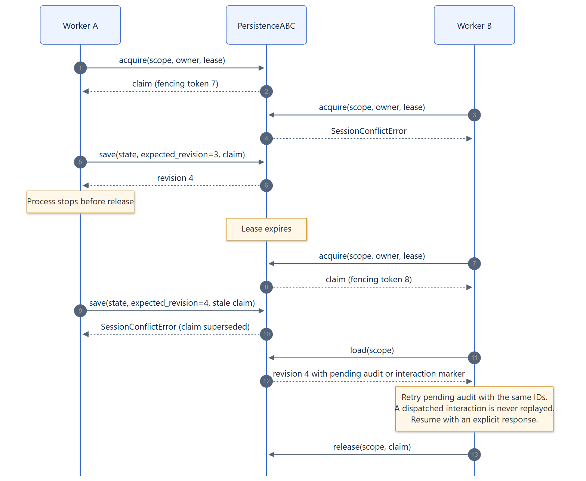

# Persistence and recovery

A standalone assessment is a **session**: the task, requirements, questions,
accepted answers, pending audit intent, and terminal result, saved after every
step. Sessions make an assessment resumable after an interrupted interaction,
a failed audit, or a process restart.

## Scope

Every session belongs to a `SessionScope` of `application_id`, `tenant_id`,
and `session_id`. The first two come from the engine; the session ID is passed
to `execute` or generated. Your application must authorize the scope before
calling the engine; an identifier is not an authorization token.

## Claims, revisions, and fencing

`execute` holds an exclusive, expiring **claim** on its session for as long as
it runs, and renews it before each step. Each save names the revision it read
and the claim it holds:

- A second writer for the same session fails with `SessionConflictError`
  instead of interleaving its changes.
- A writer whose claim expired, or was taken over, cannot overwrite the newer
  owner's state, because its fencing token no longer matches.
- A stale revision fails the write; nothing is merged silently.

{ .diagram }

## Storage

`InMemoryPersistence` is the default. It is thread-safe and copy-isolated, but
it does not survive a restart. For production, implement `PersistenceABC` over
your own database:

| Method | Must |
| --- | --- |
| `acquire(scope, owner, lease_seconds)` | Atomically grant an exclusive, expiring claim, or raise `SessionConflictError` |
| `renew(scope, claim, lease_seconds)` | Extend an active claim; reject an expired or superseded one |
| `release(scope, claim)` | Release only the caller's own claim |
| `load(scope)` | Return a copy of the stored session, or `None` |
| `save(scope, state, expected_revision, claim)` | Write only if the revision and claim still match |
| `delete(scope, expected_revision, claim)` | Delete only if the revision and claim still match |

See [Use durable storage](../how-to/durable-storage.md) for a checklist and a
contract checker.

## Stored data

Session state contains the raw task and accepted answers. Protect it with
access control, encryption, retention, and deletion policies appropriate for
that data. The envelope has `version=1` and the assessment `schema_version=1`;
an unknown version is rejected on resume, before any model call or write. See
[Compatibility](../../project/compatibility.md) before upgrading with active
sessions.

## Deleting a session

`await engine.delete_session(session_id)` deletes the standalone session and
its AGXAI run. If deletion stops partway, the session is left as a tombstone:
resuming it fails, and calling `delete_session` again finishes the deletion.

## LangGraph sessions

With the [LangGraph integration](../../integrations/langgraph.md), the graph's
checkpointer is the authoritative state. The adapter does not save a second
standalone session, and the host owns concurrency and checkpoint deletion for
the thread.
