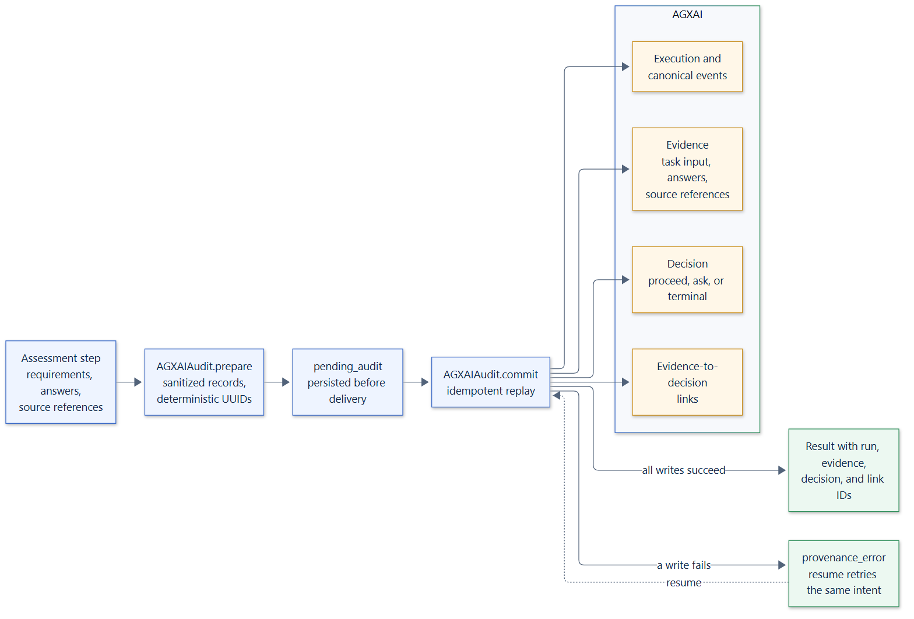

# Provenance

AGXAI is a required dependency. Every readiness decision is recorded through
AGXAI's public APIs as an execution, canonical events, evidence, a decision,
and evidence-to-decision links. Sufficiency Engine does not implement its own
provenance engine.

## What is recorded

Each assessment is one AGXAI run, scoped by `application_id`, `tenant_id`, and
the session ID as the thread. An audit record is written when the engine pauses
for clarification and when it reaches a terminal outcome.

| AGXAI record | Contents |
| --- | --- |
| `Execution` | Running, completed, cancelled, or failed |
| Canonical events | Execution started, and completed or failed |
| `Evidence` | Opaque references to the task input, accepted answers, and application source references |
| `Decision` | The selected action (`pending` or the terminal status) with requirement and blocking counts |
| `ProvenanceLink` | A `considered` link from each piece of evidence to the decision |

Records contain stable IDs and counts, never the raw task or answer text. The
result's `provenance` field holds the AGXAI run, evidence, decision, and link
IDs, so you can look the records up in your stores.

{ .diagram }

## Delivery and failure

The audit record is prepared first, saved with the session as an **outbox**
item, and only then delivered to AGXAI in strict failure mode. If delivery
fails:

- The assessment returns `status="failed"` with a retryable `provenance_error`.
  It never returns an unaudited success.
- The prepared intent stays in the session. Resuming the session retries the
  same records with the same IDs, without calling the model again; see
  [Recover an interrupted assessment](../how-to/recover-interrupted.md).

A network timeout can happen after a write was accepted, so stores must treat
a repeated write with the same ID as idempotent. There is no cross-system
exactly-once guarantee.

## Storage

`AGXAIAudit()` defaults to AGXAI's `InMemoryProvenanceStore` and an
`InMemorySemanticArchive`. Neither survives a restart. For production,
configure both:

```python
from sufficiency_engine import AGXAIAudit, SufficiencyEngine

audit = AGXAIAudit(store=durable_store, archive=durable_archive)
engine = SufficiencyEngine(model_call=model_call, audit=audit)
```

1. A durable AGXAI `ProvenanceStore` keeps executions, canonical events, and
   links.
2. A durable `SemanticArchiveABC` keeps the evidence and decision artifacts.
   AGXAI's provenance store alone does **not** persist them.

Both are application-owned, with scoped, idempotent writes. See
[Use durable storage](../how-to/durable-storage.md).

## Source references

Pass UUIDs of the documents or records a task came from as
`source_references`:

```python
result = await engine.execute(input=task, source_references=(ticket_id,))
```

Each becomes an `application_reference` evidence record linked to the
decision; the source content is never copied into AGXAI. These references are
kept at assessment level. A requirement that quotes the task cites the
task-input evidence, not every attached source, because the model's quote does
not show which source supports it.

## Inspecting provenance

AGXAI owns lineage and explainability. Query its store and semantic archive to
inspect relationships, or attach an AGXAI observability provider with
`AGXAIAudit(observer=...)` to emit its events next to your traces. Traces are
useful for correlation, but they are not an audit store.
