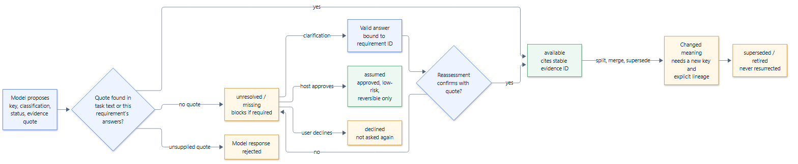

# Requirements and evidence

A requirement is one piece of information the task depends on, such as the
deployment platform or the target account. The model proposes requirements;
the engine validates each proposal and keeps the result as a `Requirement`.

## Anatomy of a requirement

| Field | Meaning |
| --- | --- |
| `id`, `key` | A stable UUID, and the key the model uses to refer to it across reassessments |
| `classification` | `mandatory`, `minimum`, or `optional` |
| `status` | `available`, `missing`, `unresolved`, `assumed`, or `declined` |
| `lifecycle` | `active`, `satisfied`, `superseded`, or `retired` |
| `blocking` | Set by the [readiness policy](readiness-policy.md), never by the model |
| `source_evidence_ids` | The evidence the availability is based on |
| `dependencies` | Requirements this one depends on |
| `parent_ids` | The requirements it replaced through lineage |

Classification, status, and lifecycle are independent. A mandatory requirement
can be unresolved and active; an optional one can be available and satisfied.

## What the model proposes

Each proposal has a key, a description, a classification, a status of
`available` or `unresolved`, a reason, and a necessity decision:

| Necessity | The model suggests |
| --- | --- |
| `must_ask` | Asking the user; the proposal must include a question |
| `may_assume` | A default value; the proposal must include an assumption |
| `may_defer` | Leaving it for later |
| `must_block` | Blocking without a question |
| `not_needed` | That nothing is needed |

A proposal may also declare an answer type (`string`, `integer`, `number`,
`boolean`, `array`, `object`, or `any`), declarative constraints such as
`choices`, `minimum`, or `max_length`, and dependencies on other keys. Unknown
fields are rejected.

## Evidence

An `available` proposal must include an `evidence_quote`: an exact substring
of the task text, or of a valid answer to **that same requirement**. Anything
else is rejected:

- A quote that appears nowhere in the supplied data fails the response with a
  `model_response_error`.
- A quote from another requirement's answer is not accepted, so one answer can
  never make a different requirement available.
- A requirement created through explicit lineage may cite its parents' answers.

A quote proves what was supplied, not that the statement is true.

{ .diagram }

## Stable identity and lineage

A key keeps its meaning. Its description, classification, answer type, answer
slot, and constraints are frozen once the requirement exists. To change any of
them, the model must propose a new key with explicit lineage:

| Operation | Shape |
| --- | --- |
| `split` | One parent into two or more successors |
| `merge` | Two or more parents into one successor |
| `supersede` | One parent replaced by one successor |
| `retire` | One parent with no successor |

Lineage is checked strictly. A successor cannot weaken its parents'
classification, an unresolved or referenced requirement cannot be retired, and
an inactive requirement cannot return under its old key. The resulting
`RequirementLineage` records are returned in the result's `lineage`, and each
successor keeps its parents in `parent_ids`.

## Source references

`execute` accepts `source_references`: UUIDs of documents or records the task
came from. They are recorded as assessment-level references. Because a model
quote cannot show which source supports a requirement, the engine does not
attach every source to every requirement. See
[Provenance](provenance.md#source-references).
