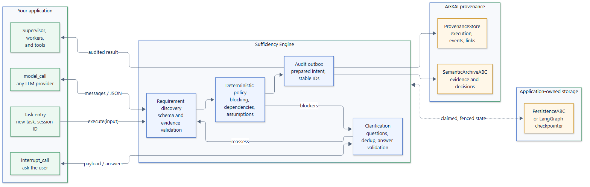

---
hide:
  - navigation
  - toc
---

<div class="se-hero" markdown>

# Sufficiency Engine

<p class="se-tagline">Decide whether a task has enough information to proceed,
before your agent starts work. Sufficiency Engine finds the requirements a task
depends on, asks only the questions that matter, and records every readiness
decision with AGXAI provenance.</p>

[Get started](getting-started/index.md){ .md-button .md-button--primary }
[Browse examples](examples/index.md){ .md-button }
[API reference](api/index.md){ .md-button }

</div>

## Why Sufficiency Engine

Agents usually start a task with whatever the user typed. When the platform,
the account, or the deadline is missing, the agent guesses, or asks a string of
loosely related questions. Sufficiency Engine answers one question first:
**does this task have enough information to proceed safely and correctly?**
A model proposes the requirements, deterministic Python policy decides what
blocks, and the outcome is recorded as evidence and decisions.

<div class="grid cards" markdown>

-   :material-scale-balance:{ .lg .middle } __Model proposes, policy decides__

    ---

    The model suggests requirements, evidence quotes, and whether to ask.
    Python validates every proposal and alone sets the blocking flag.

-   :material-text-search:{ .lg .middle } __Evidence, not guesses__

    ---

    An `available` requirement must quote the task or an accepted answer for
    that requirement. Unsupported quotes are rejected, never trusted.

-   :material-comment-question-outline:{ .lg .middle } __Only the questions that matter__

    ---

    Questions are combined, deduplicated, and never repeated after a decline.
    Zero questions is a valid outcome.

-   :material-file-certificate-outline:{ .lg .middle } __Audited with AGXAI__

    ---

    Every terminal outcome records evidence, decisions, and links in AGXAI.
    A failed audit is a failed assessment, never a silent success.

-   :material-backup-restore:{ .lg .middle } __Recoverable by design__

    ---

    Claims, revisions, and fencing protect sessions. An interrupted
    interaction or audit resumes without rediscovery or replayed side effects.

-   :material-puzzle-outline:{ .lg .middle } __Provider- and framework-neutral__

    ---

    Bring any model through one callback. LangGraph and OpenTelemetry are
    optional extras; storage and embeddings plug in through ABCs.

</div>

## Thirty-second tour

```bash
pip install sufficiency-engine
```

A deployment task names no platform. The engine asks one question, reassesses
with the answer, and returns an audited result. The model callback is
deterministic here so the example runs offline; in your application it calls
your own model:

<!-- fmt: off -->
```python
--8<-- "examples/quickstart.py"
```
<!-- fmt: on -->

Output:

```text
Question: Which platform should the service be deployed on?
Status: sufficient
Sufficient: True
Clarification rounds: 1
  platform: available, blocking=False
Audited decisions: 2
```

Your application keeps the model, the conversation, and the work itself.
Sufficiency Engine only decides readiness:

{ .diagram }

## Let your coding agent integrate it

Install the [Sufficiency Engine Agent Skills](agent-skills/index.md) and your
coding agent learns the workflow and safety rules for adding readiness checks to
your application, and for implementing durable storage and embeddings:

```text title="Agent instruction"
Install the Agent Skills from https://github.com/smuniharish/sufficiency-engine
(sufficiency-engine-skills/skills/sufficiency-engine and
sufficiency-engine-skills/skills/sufficiency-engine-extend) into this project,
run the sufficiency-engine skill's scripts/verify_setup.py, then add a task
readiness check at this application's task entry, following the skill's
workflow and safety rules.
```

## Where to go next

<div class="grid cards" markdown>

-   :material-rocket-launch:{ .lg .middle } __[Quickstart](getting-started/quickstart.md)__

    ---

    Connect a model, collect a missing answer, and read the result.

-   :material-book-open-variant:{ .lg .middle } __[User guide](guide/index.md)__

    ---

    Requirements, readiness policy, clarification, persistence, and
    provenance, plus how-to guides.

-   :material-connection:{ .lg .middle } __[Integrations](integrations/index.md)__

    ---

    LangGraph task entry, OpenTelemetry, and any other framework.

-   :material-code-braces:{ .lg .middle } __[Examples](examples/index.md)__

    ---

    Complete programs, run in the test suite, with their real output.

-   :material-sitemap-outline:{ .lg .middle } __[Architecture](architecture/index.md)__

    ---

    Components, the assessment lifecycle, and every extension point.

-   :material-api:{ .lg .middle } __[API reference](api/index.md)__

    ---

    Every public class and method, generated from the source.

</div>

!!! warning "Readiness is not a safety guarantee"
    A model can miss or misclassify requirements, and the engine sees only the
    supplied task and answers. Your application remains responsible for
    authorization, task execution, and independent safety checks.
