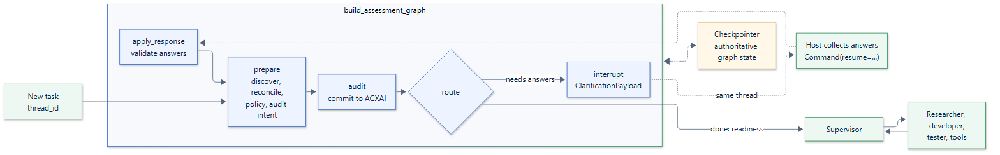

# LangGraph

`build_assessment_graph` returns a compiled LangGraph subgraph that assesses a
task once, at task entry, and pauses with a LangGraph `interrupt` when it needs
answers. Your graph routes on the result.

```bash
pip install "sufficiency-engine[langgraph]"
```

{ .diagram }

## Add the subgraph

Your graph state needs the subgraph's fields: `task`, `session_id`,
`assessment`, `response`, and `readiness`. Optionally add `source_references`
as a list of UUID strings.

```python
from langgraph.checkpoint.memory import InMemorySaver
from langgraph.graph import END, START, StateGraph
from langgraph.types import Command
from pydantic import BaseModel, JsonValue

from sufficiency_engine import AssessmentResult, SufficiencyEngine
from sufficiency_engine.integrations.langgraph import build_assessment_graph


class HostState(BaseModel):
    task: str
    session_id: str
    assessment: dict[str, JsonValue] | None = None
    response: JsonValue = None
    readiness: dict[str, JsonValue] | None = None


engine = SufficiencyEngine(model_call=model_call)

builder = StateGraph(HostState)
builder.add_node("readiness", build_assessment_graph(engine))
builder.add_node("work", do_work)
builder.add_edge(START, "readiness")
builder.add_conditional_edges(
    "readiness",
    lambda state: "work" if AssessmentResult.model_validate(state.readiness).sufficient else "stop",
    {"work": "work", "stop": END},
)
builder.add_edge("work", END)
graph = builder.compile(checkpointer=InMemorySaver())
```

`model_call` and `do_work` are yours. The engine's `interrupt_call` and
`command_call` are not used by the subgraph: LangGraph's `interrupt` asks the
questions, and your graph acts on the result.

## Answer the questions

The first invocation pauses. The interrupt value is a `ClarificationPayload` as
JSON. Resume the same thread with an `InteractionResponse`:

```python
config = {"configurable": {"thread_id": "task-42"}}
paused = await graph.ainvoke({"task": task, "session_id": "task-42"}, config)

payload = paused["__interrupt__"][0].value
question = payload["questions"][0]
response = {
    "answers": [{"question_id": question["id"], "values": {question["requirement_ids"][0]: answer}}]
}
finished = await graph.ainvoke(Command(resume=response), config)
```

The subgraph then reassesses with the answer, and either pauses again or writes
the final `readiness`.

## Recovery

The checkpointer is the authoritative state. The subgraph does not save a
second standalone session.

- **Process restart:** with a durable checkpointer, resume the same thread ID.
  The [PostgreSQL recovery example](../examples/postgres-recovery.md) shows this
  across two processes.
- **Malformed response:** the response is rejected, one iteration is consumed,
  and the subgraph interrupts again with the same questions. When the budget
  runs out, the result is `iteration_limit_reached`.
- **AGXAI outage:** `readiness` is a `failed` result with `provenance_error`,
  and the audit intent stays in the `assessment` state. After the store
  recovers, invoke the thread again with the same `task`, `session_id`, and
  that `assessment`. The same records are retried, and the model is not called
  again.

## What to know

- Assess each task once, at entry. Ordinary worker steps do not need
  reassessment; assess a genuinely new task explicitly.
- The host owns the checkpointer, its durability, concurrency, and deletion.
  `engine.delete_session` does not delete graph checkpoints.
- Checkpoints contain the raw task and answers. Protect them like sessions.
- Discovery runs inside a graph node. If the process stops during discovery,
  LangGraph re-runs the node and the model is called again.

See the [supervisor-worker example](../examples/supervisor-worker.md) for a
complete graph.
